# Spectrum — Нативный Hi-Res / DSD плеер студийного класса для Windows

**Автор и разработчик:** Пасечник Алексей Сергеевич ([VK: vk.ru/thepasechnik](https://vk.ru/thepasechnik))  
**Языки:** Русский • English • Қазақша • Беларуская (автоопределение языка Windows + ручной выбор)

> ### 🎧 Бескомпромиссное нативное качество — полное закрытие потребностей любого аудиофила
> **Spectrum** написан на чистом нативном **C++20 + Direct2D + WASAPI Exclusive / ASIO** — без Electron, браузерных движков и системного микшера Windows. Весь плеер весит **~4 МБ** (меньше одной MP3-песни!), стартует мгновенно, рисует интерфейс в честных 60 FPS на GPU и отдаёт звук в ваш ЦАП **бит-в-бит (`Bit-Perfect`)** с нативным **DSD64–DSD512** и апсемплингом `PCM → DSD` на лету.

---

## Чем Spectrum отличается от всех других плееров

| Возможность | **Spectrum** | foobar2000 / AIMP | Roon / Audirvana | Spotify / Яндекс / VK |
|---|---|---|---|---|
| **Вес и скорость** | **~4 МБ**, нативный C++20, старт <0.2с | ~15–40 МБ, старый UI | 250+ МБ, тяжёлые БД | 200–400 МБ (Electron) |
| **Нативный Bit-Perfect (WASAPI Excl / ASIO)** | **Из коробки в 1 клик** + привязка пресета к ЦАП | Нужны плагины и ручная настройка | Есть (дорого) | Нет (через микшер OS) |
| **Нативный DSD512 + `PCM → DSD` на лету** | **Встроенный 4th-order Sigma-Delta модулятор** | Нужны сторонние компоненты | Есть (платно) | Нет |
| **Детектор фейкового Hi-Res (реальный FFT)** | **Да! Сразу ловит апскейл 16 / 20 кГц и считает DR** | Нет из коробки | Нет | Нет |
| **Акустический ИИ-анализ настроения + BPM** | **Да! Локально без интернета + Кольцо настроений** | Нет | Нет | Только по серверным тегам |
| **Встроенное Hi-Res Радио + Радар + Запись** | **213 станций (10 полок), 60 FPS Радар, запись до 3 потоков `● REC`** | Базовые ссылки без анализа | Ограничено | Нет |
| **Студийный Мастер-тракт** | **`PURE AUDIO 0% DSP`, `+DR`, импеданс 16–600 Ω, кроссфид, фазометр** | Отдельные DSP-плагины | Базовый DSP | Нет |
| **Интерфейс 60 FPS GPU + 3 режима** | **7 студийных тем, 8 скинов, шейдеры, радиальное меню, Островок, «Всё в одном»** | Классические окна | Таблицы | Веб-интерфейс |

---

## Что нового в версии 2.4.2

- **Фирменная иконка Spectrum ID** — обновлённый единый визуальный стиль на Windows и Android.
- **Полная синхронизация каталога радио с Android (213+ станций):** 10 жанровых полок (*FLAC Lossless, Электро, Металл, Джаз/Лаунж, Рок/Ретро, Классика, Мир/Фолк, Попса, Шансон, Рэп*) с автоматической фильтрацией по подстилям, **60 FPS Direct2D Радар-сканером эфира** и **умной записью до 3 потоков одновременно** в `Saved Radio/`.
- **Спокойная студийная цветовая палитра** — убраны излишне резкие «вырвиглазные» акценты, добавлена тема **Windows 12**; интерфейс стал мягче и комфортнее для глаз при долгом прослушивании.

---

## Скриншоты интерфейса

### 1. Полноэкранный режим «Всё в одном» (`3` / `F11`)
Единое полноэкранное пространство из трёх колонок (**Плеер + Студийный Мастер + Реальный FFT-детектор | Hi-Fi Медиатека с тегами настроений | Плейлист и Очередь**):

| Полноэкранный «Всё в одном» — Стекло (Liquid Glass) | Полноэкранный «Всё в одном» — Киберпанк |
|---|---|
|  | 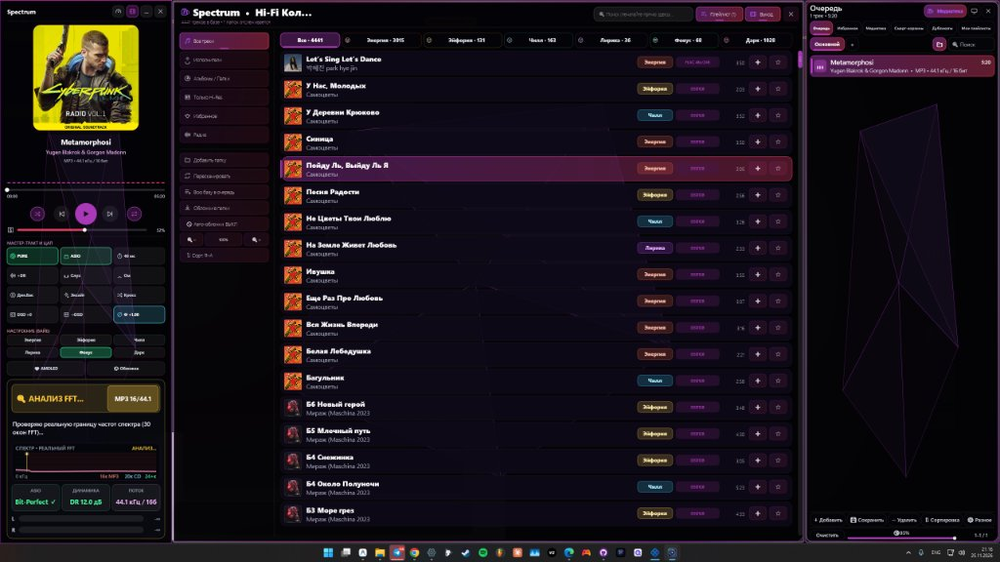 |

### 2. Компактный плеер (`1`), Мастер-тракт (`T`), Эффекты (`E`) и Радиальное меню
Выдвижные полупрозрачные панели без наложений, **Радиальное веерное меню** по правому клику (темы, ЦАП, DSP, импеданс наушников, буфер и обновление в одно движение) и **Динамический островок (`2`)** поверх всех окон:

| Компактный плеер | Студийный Мастер-тракт (`T`) | Живые эффекты и погода (`E`) |
|---|---|---|
| 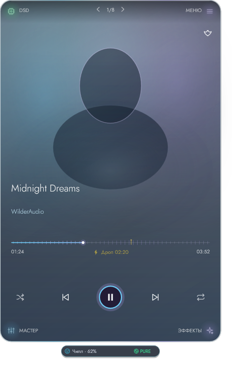 | 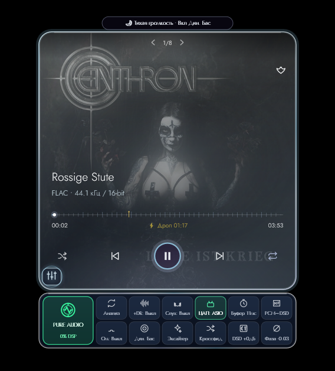 | 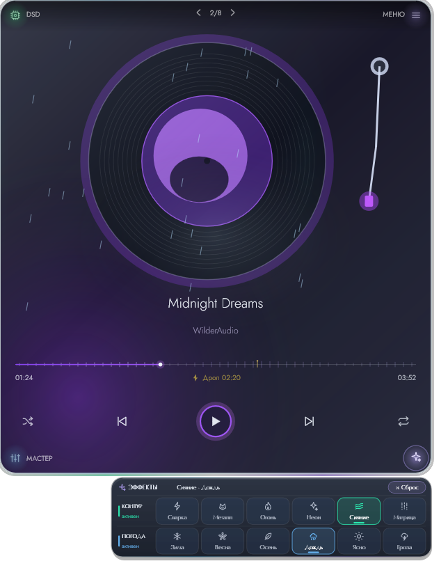 |

| Радиальное веерное меню (ПКМ) | Динамический островок (`2`) |
|---|---|
| 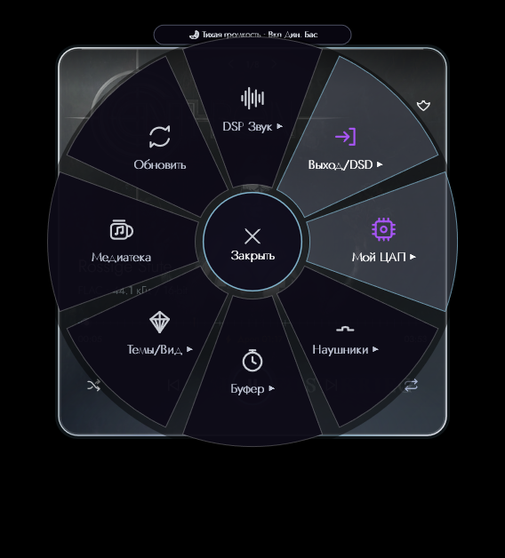 | 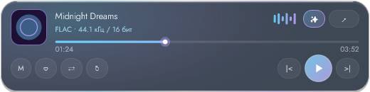 |

### 3. Все 7 студийных тем оформления (спокойная палитра v2.4.2) + 8 скинов-визуализаторов
Выбирайте материал под настроение: *Стекло, Обсидиан, Чёрный металл, Дерево, Киберпанк, Карбон, Windows 12* — и любой из 8 живых визуализаторов (обложка, вращающийся винил с тонармом, зеркальный FFT, ночной мегаполис и др.):

| Стекло (Liquid Glass) | Обсидиан • Графит | Киберпанк • Винил |
|---|---|---|
| 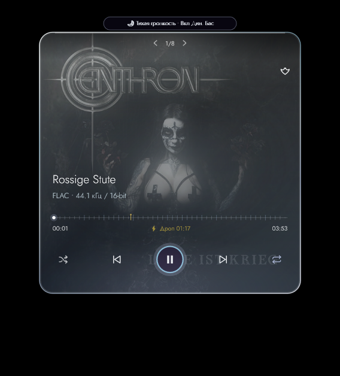 | 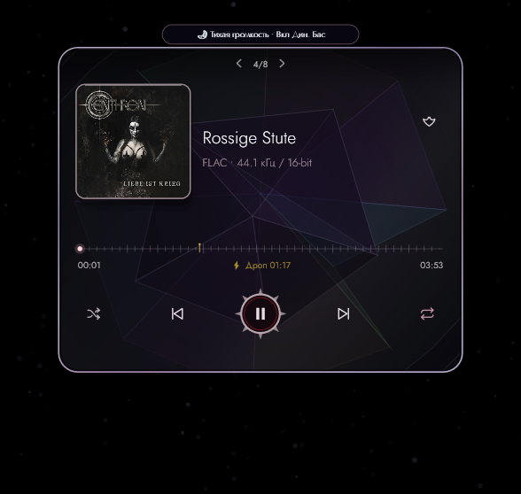 | 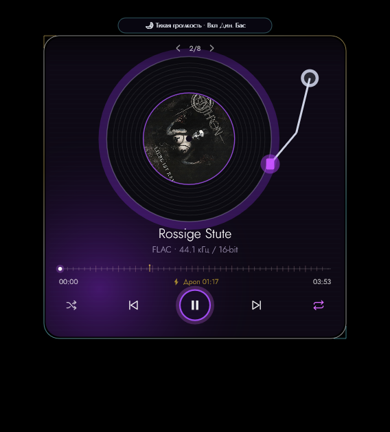 |

| Карбон • Золотой акцент | Дерево • Тёплая студия | Windows 12 • Mica |
|---|---|---|
| 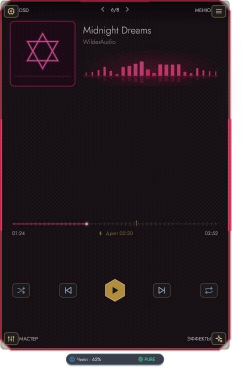 | 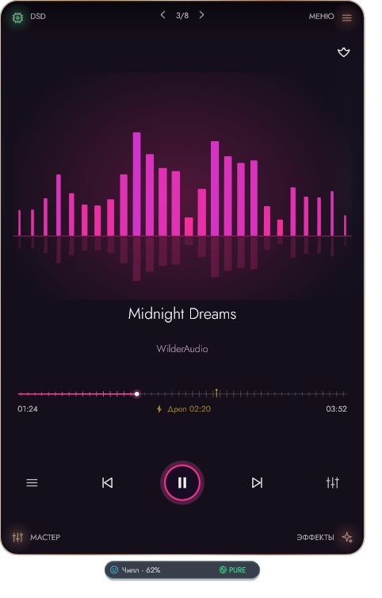 | 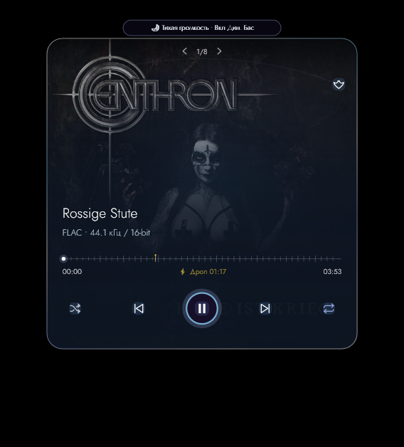 |

| Чёрный металл • Титан | Кольцо настроений + BPM |
|---|---|
| 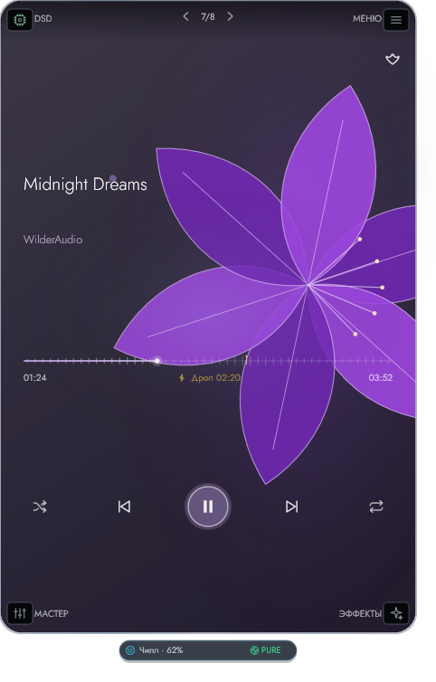 | 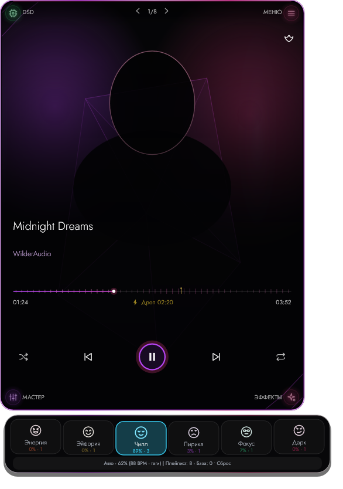 |

### 4. Быстрая Hi-Fi Медиатека (`L`) и Умный Плейлист (`P`)
Тысячи треков без тормозов, фильтрация по настроениям и Hi-Res/DSD, **встроенное Радио (213 станций по 10 полкам)**, вкладки плейлистов, поиск дубликатов и смарт-корзины:

| Hi-Fi Медиатека | Киберпанк Медиатека | Умный Плейлист и Очередь |
|---|---|---|
| 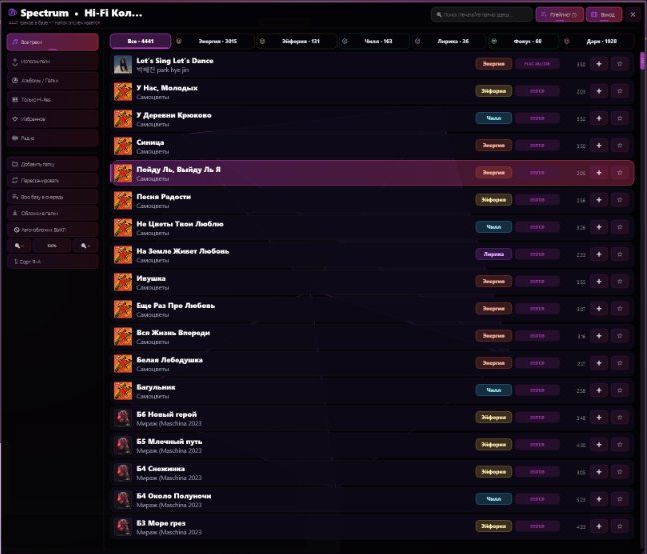 | 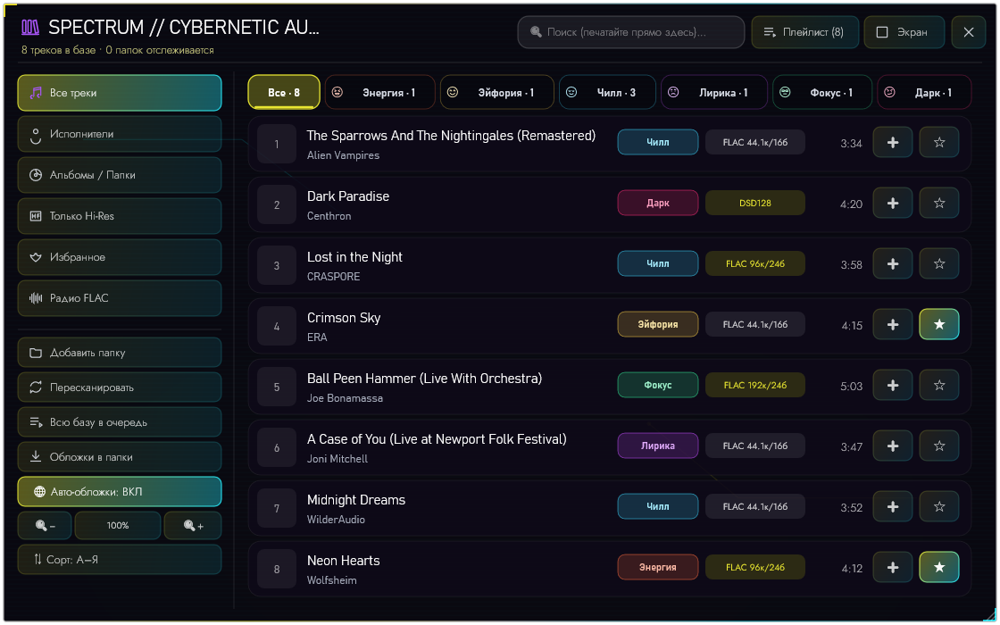 | 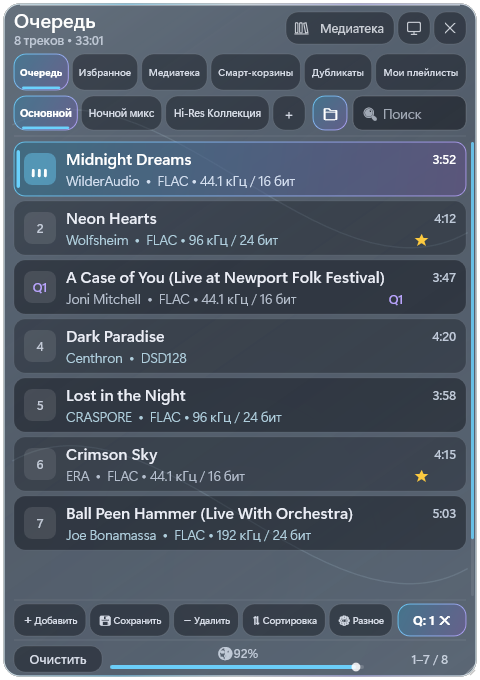 |

---

## Полный перечень возможностей

### 1. Чистота звукового тракта (Bit-Perfect & Hi-Res)
- **WASAPI Exclusive (Event-Driven)** и **ASIO** — прямой монопольный вывод в ваш ЦАП или звуковую карту в обход системного микшера Windows. Автоматическое запоминание пресета под каждый подключённый ЦАП.
- **PURE AUDIO (`0% DSP`, клавиша `U`)** — мгновенное отключение эквалайзера и всех обработок для эталонного Bit-Perfect воспроизведения.
- **Нативный DSD (DSD64–DSD512, файлы `.dsf` / `.dff`)** + плавное усиление DSD (`+0 / +3 / +6 дБ`) с защитой от клиппинга.
- **Апсемплинг `PCM → DSD` на лету (`D`)** — 4th-order Sigma-Delta модулятор, переводящий FLAC/MP3/PCM в 1-битный DSD (работает в ASIO и WASAPI Exclusive DoP) для обхода штатных PCM-фильтров ЦАП.
- **Детектор фейкового Hi-Res (реальный FFT)** — сразу показывает реальную частотную границу трека:
  - `⚠ ФЕЙК HI-RES (срез 16 кГц)` — пережатый MP3 в обёртке FLAC;
  - `⚠ АПСКЕЙЛ CD (срез 20 кГц)` — растянутый 44.1 кГц CD-мастер;
  - `💎 ПОДЛИННЫЙ HI-RES (>20 кГц)` и `✦ ЧИСТЫЙ DSD`.
- **Студийный Мастер-тракт (`T`):**
  - `+DR` — восстановление динамического диапазона для пережатых треков;
  - Адаптация под импеданс наушников (`16–32 Ω`, `32–80 Ω`, `80–250 Ω`, `250–600 Ω`, `BT / ANC`);
  - Профили слуха (`+Воздух`, `Релакс`, `Голос`);
  - Динамический бас (тонкомпенсация на тихой громкости), гармонический эксайтер, кроссфид для наушников, фазовый коррелометр и профилировщик задержки буфера.

### 2. Интерфейс 60 FPS и 3 режима работы
- **Обычный компактный плеер (`1`)** — 7 тем оформления, 8 скинов, 4 выдвижные полупрозрачные панели (`DSD`, `МЕНЮ`, `МАСТЕР`, `ЭФФЕКТЫ`), **Радиальное веерное меню** по правому клику и режим свайпа обложек (`Ctrl+D`) с живым предпрослушиванием фрагмента.
- **Динамический островок (`2`)** — невесомая мини-капсула поверх всех окон с живым эквалайзером и плавным раскрытием при наведении.
- **Полноэкранный режим «Всё в одном» (`3` / `F11`)** — 3 колонки (`Плеер + Студийный Мастер + FFT-анализатор | Медиатека | Плейлист`) + эксклюзивные режимы **`🖤 AMOLED`** (`#000000`) и **`🎨 Обложка`** (подстройка палитры под обложку текущего трека).

### 3. Логистика библиотеки и «Радио Spectrum» (213+ станций)
- **Быстрая Медиатека (`L`):** тысячи треков без лагов, мгновенный поиск (`Ctrl+K`), круглое колесо алфавита, автоанализ настроения и BPM, Drag-and-Drop треков и альбомов прямо в плейлист.
- **Умные обложки:** автоматический поиск и сохранение обложек **строго в папки с вашей музыкой** (никакого мусорного кэша на диске `C:`).
- **Плейлисты (`.m3u8`):** вкладки плейлистов, поиск дубликатов, Умная корзина, интеграция с Проводником Windows.
- **Радио Spectrum (213+ живых станций, синхронизировано с Android):** 10 жанровых полок (*FLAC Lossless, Электро, Металл, Джаз/Лаунж, Рок/Ретро, Классика, Мир/Фолк, Попса, Шансон, Рэп*), каталог Radio Browser API, **60 FPS Радар-сканер эфира** и **умная запись до 3 потоков одновременно (`● REC`)** в папку `Saved Radio/` с отображением живого битрейта.
- **Автообновление с GitHub** прямо из плеера в один клик.

---

## Установка и активация

1. Скачайте **[Spectrum_Setup.exe](Spectrum_Setup.exe)** из раздела **Releases**.
2. Запустите установщик (права администратора не требуются), выберите нужные ассоциации файлов и ярлыки.
3. После запуска доступно **3 часа полноценного демо-режима** с живым таймером на главном экране.
4. **Два способа бесплатной активации навсегда:**
   - **Способ 1 (Мгновенно без ожидания!):** прямо в окне активации выберите жанр по вкусу и послушайте **минимум 3 трека** автора на Яндекс Музыке, VK или Spotify (по 30 сек каждый) — плеер сам зафиксирует прослушивание и автоматически активирует полную версию:
     - *Тёмный альт-поп / готик-электро:* **SABLE XIII** («Швы», «Посмотри на меня»), **K1LLA DOLL** («Выставочный формат»)
     - *Синтвейв / ретро-неон (Яндекс / VK):* **Лунная Кассета** («Розовый Неон», «Бриллианты из дата-центра»), **NITRA** («Сдвиг в темноте»)
     - *Киберпанк / мрачный рок (везде):* **Kinchesapet** («Cyberstorm», «Eclipse Code», «E.X.T»), **Распад** («Intro»), **Crimson Valkyrie**
   - **Способ 2 (Если не хочется ничего слушать):** скопируйте свой **`Код ПК (HWID)`** и напишите Алексею в VK: **[https://vk.ru/thepasechnik](https://vk.ru/thepasechnik)** — он сгенерирует и пришлёт ключ лично.

---

## Горячие клавиши

| Клавиша | Действие |
|---|---|
| `Пробел` | Играть / Пауза |
| `←` / `→` | Перемотка −5с / +5с |
| `N` / `B` или `Ctrl+→` / `Ctrl+←` | Следующий / Предыдущий трек |
| `↑` / `↓` / `M` | Громкость ±5% / Без звука (Mute) |
| `S` / `R` / `F` | Перемешать / Повтор / В избранное |
| `L` / `P` / `O` | Медиатека / Плейлист / Открыть файлы |
| `1` / `2` / `3` (`F11`) | Обычный вид / Островок / Всё в одном |
| `U` / `D` / `T` / `E` | PURE AUDIO / PCM→DSD / Мастер / Эффекты |
| `ПКМ` / `Ctrl+D` / `Ctrl+K` / `Q` / `F1` | Радиальное меню / Свайп / Поиск / Производительность / Справка |
