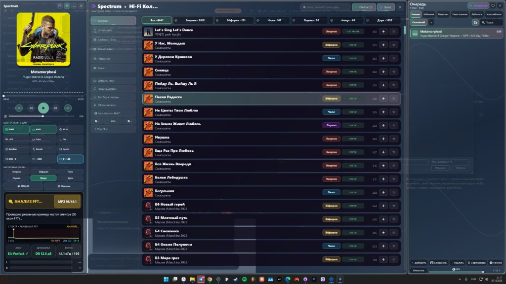

# Spectrum — Аудиофильский Hi-Res / DSD плеер для Windows

**Автор и разработчик:** Пасечник Алексей Сергеевич ([VK: vk.ru/thepasechnik](https://vk.ru/thepasechnik))  
**Языки:** Русский • English • Қазақша • Беларуская (автоопределение языка Windows + ручной выбор)

> ### ⚡ Рекордная компактность: всего ~4 МБ нативного C++20 кода!
> Пока современные плееры на Electron весят по **150–300 МБ** и съедают гигабайт оперативки, **Spectrum** написан на чистом нативном **C++20 + Direct2D + WASAPI/ASIO** — весит меньше одной MP3-песни (~3.95 МБ!), стартует мгновенно, не грузит процессор и при этом даёт студийный функционал, которого нет в подавляющем большинстве тяжёлых комбайнов.

> **Почему в плеере есть демо-режим и активация по ключу?**
>
> Привет! Я потратил около недели плотной разработки и вайбкодинга, исправил десятки сложных багов с WASAPI/DSD/интерфейсом и вложил в этот плеер душу. Просто так без обратной связи выложить и не знать, нужен ли он вообще людям, я не могу — **ключ активации сейчас нужен исключительно для того, чтобы понять реальный спрос**.
>
> **Прямо сейчас я генерирую и отдаю персональный ключ ЛИЧНО КАЖДОМУ — абсолютно бесплатно.** В будущем проект может стать платным, но сегодня достаточно скачать плеер, попробовать его в 3-часовом демо-режиме и написать мне в VK ([vk.ru/thepasechnik](https://vk.ru/thepasechnik)), прислав свой **Код ПК (HWID)** — я сразу пришлю ключ!

---

## Скриншоты интерфейса

### Полноэкранный режим «Всё в одном» (Плеер + Медиатека + Плейлист + Адаптивная тема «Обложка»)

*(При желании добавьте сюда также `screenshots/normal_mode.png` и `screenshots/dynamic_island.png` — достаточно положить файлы в папку `screenshots/` рядом с этим README.)*

---

## Полный перечень возможностей

### 1. Чистота звукового тракта (Bit-Perfect & Hi-Res)
- **WASAPI Exclusive (Event-Driven)** и **ASIO** — прямой монопольный вывод в ваш ЦАП или звуковую карту в обход системного микшера Windows.
- **PURE AUDIO (`0% DSP`)** — мгновенное отключение эквалайзера и всех обработок для эталонного Bit-Perfect воспроизведения.
- **Нативный DSD (DSD64–DSD512, файлы `.dsf` / `.dff`)** + плавное усиление DSD (`+0 / +3 / +6 дБ`) с защитой от клиппинга.
- **Апсемплинг `PCM → DSD` на лету** — 4th-order Sigma-Delta модулятор, переводящий FLAC/MP3/PCM в 1-битный DSD (работает в ASIO и WASAPI Exclusive DoP) для обхода штатных PCM-фильтров ЦАП.
- **Детектор фейкового Hi-Res (FFT)** — наглядно показывает реальную частотную границу трека:
  - `⚠ ФЕЙК HI-RES (срез 16 кГц)` — пережатый MP3 в обёртке FLAC;
  - `⚠ АПСКЕЙЛ CD (срез 20 кГц)` — растянутый 44.1 кГц CD-мастер;
  - `💎 ПОДЛИННЫЙ HI-RES (>20 кГц)` и `✦ ЧИСТЫЙ DSD`.
- **Студийный Мастер-тракт:**
  - `+DR` (восстановление динамического диапазона для пережатых треков);
  - Адаптация под импеданс наушников (`16–32 Ω`, `32–80 Ω`, `80–250 Ω`, `250–600 Ω`, `BT / ANC`);
  - Профили слуха (`+Воздух`, `Релакс`, `Голос`);
  - Динамический бас (тонкомпенсация на тихой громкости), гармонический эксайтер, кроссфид для наушников, фазовый коррелометр и профилировщик задержки буфера.

### 2. Интерфейс Liquid Glass и 3 режима работы
- **Обычный компактный плеер (`1`)** — 8 скинов, 4 выдвижные полупрозрачные панели (`DSD`, `МЕНЮ`, `МАСТЕР`, `ЭФФЕКТЫ`) с взаимным исключением без наложений.
- **Динамический островок (`2`)** — невесомая мини-капсула поверх всех окон + плавный выезд плейлиста у правого края экрана.
- **Полноэкранный режим «Всё в одном» (`3` / `F11`)** — 3 колонки (`Плеер + Студийный Мастер + Liquid FFT-анализатор | Медиатека | Плейлист`) + эксклюзивные полноэкранные темы:
  - **`🖤 AMOLED`** — абсолютно чёрный `#000000` фон;
  - **`🎨 Обложка`** — вся цветовая палитра всех трёх панелей медленно и плавно переливается в тон обложки текущего трека.

### 3. Логистика локальной библиотеки и «Радио FLAC»
- **Быстрая Медиатека:** тысячи треков без лагов, мгновенный поиск, строгая сортировка по алфавиту, круглое колесо алфавита, Drag-and-Drop треков и альбомов прямо в плейлист.
- **Умные обложки:** автоматический поиск и сохранение обложек **строго в папки с вашей музыкой** (никакого мусорного кэша на диске C:).
- **Плейлисты (`.m3u8`):** вкладки плейлистов, сохранение в «Мои плейлисты», поиск дубликатов, Умная корзина, интеграция с Проводником Windows.
- **Встроенное «Радио FLAC»:** 19+ проверенных бесплатных Lossless / Ogg-FLAC радиостанций без авторизации (Рок, Электроника, Чилл, Классика, Джаз/Hi-Fi), живой каталог Radio Browser API, Избранное и отображение **живого битрейта (кбит/с)** прямо на главном экране.

---

## Установка и активация

1. Скачайте **[Spectrum_Setup.exe](Spectrum_Setup.exe)** из раздела **Releases**.
2. Запустите установщик (права администратора не требуются), выберите нужные ассоциации файлов и ярлыки.
3. После запуска доступно **3 часа полноценного демо-режима** с живым таймером на главном экране.
4. **Два способа бесплатной активации навсегда:**
   - **Способ 1 (Мгновенно без ожидания!):** прямо в окне активации выберите жанр по вкусу и послушайте **минимум 3 трека** автора на Яндекс Музыке, VK или Spotify (по 30 сек каждый) — плеер сам зафиксирует прослушивание и автоматически активирует полную версию:
     - *Тёмный альт-поп / готик-электро:* **SABLE XIII** («Швы», «Посмотри на меня»), **K1LLA DOLL** («Выставочный формат»)
     - *Синтвейв / ретро-неон (Яндекс / VK):* **Лунная Кассета** («Розовый Неон», «Бриллианты из дата-центра»), **NITRA** («Сдвиг в темноте»)
     - *Киберпанк / мрачный рок (везде):* **Kinchesapet** («Cyberstorm», «Eclipse Code», «E.X.T»), **Распад** («Intro»), **Crimson Valkyrie**
   - **Способ 2 (Если не хочется ничего слушать):** скопируйте свой **`Код ПК (HWID)`** и напишите Алексею в VK: **[https://vk.ru/thepasechnik](https://vk.ru/thepasechnik)** — он сгенерирует и пришлёт ключ лично.

---

## Горячие клавиши

| Клавиша | Действие |
|---|---|
| `Пробел` | Играть / Пауза |
| `←` / `→` | Перемотка −5с / +5с |
| `N` / `B` или `Ctrl+→` / `Ctrl+←` | Следующий / Предыдущий трек |
| `↑` / `↓` / `M` | Громкость ±5% / Без звука (Mute) |
| `S` / `R` / `F` | Перемешать / Повтор / В избранное |
| `L` / `P` / `O` | Медиатека / Плейлист / Открыть файлы |
| `1` / `2` / `3` (`F11`) | Обычный вид / Островок / Всё в одном |
| `U` / `D` / `T` / `E` | PURE AUDIO / PCM→DSD / Мастер / Эффекты |
| `Q` / `Ctrl+K` / `Ctrl+D` / `F1` | Производительность / Поиск / Свайп / Справка (FAQ) |
